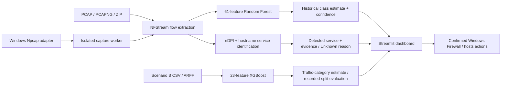

# AI-Powered Encrypted Network Traffic Classifier

Existing Streamlit application for classifying encrypted network flows on Windows.

- PCAP, PCAPNG, or ZIP containing a capture: NFStream extraction and the trained Random Forest (61 features).
- Scenario B CSV/ARFF: the trained XGBoost classifier (23 features, seven traffic classes).
- Live capture: a background NFStream capture with observed service evidence, charts, recent flows, CSV export, and separate Random Forest predictions.
- Scenario B evaluation: the original stratified 80/20 split with `random_state=42`, confusion matrix, precision, recall, and F1 scores.
- Persistent domain/IP blocklist, outbound Windows Firewall rules, and managed Windows hosts-file entries.

## Architecture and result meanings



Detected services use observed protocol or hostname evidence. The Random Forest predicts five historical application classes; XGBoost predicts seven separate Scenario B traffic categories. Unknown and Ambiguous preserve uncertainty. None of these outputs proves a Windows process identity. The [final project report](reports/FINAL_PROJECT_REPORT.md) and [model audit](reports/model_evaluation/README.md) contain the demonstration method and per-class results.

## Windows 11 setup and launch

Use 64-bit Python 3.13. Install [Npcap from its official site](https://npcap.com/) before live capture; [NFStream's Windows notes](https://github.com/nfstream/nfstream) state that the capture driver is a separate installation. If Npcap was installed in restricted-admin mode, launch PowerShell as Administrator for capture. The application does not install or modify the driver.

From the project root in PowerShell, create a virtual environment only if one is not already available:

```powershell
py -3.13 -m venv .venv
.\.venv\Scripts\python.exe -m pip install -r requirements.txt
.\.venv\Scripts\python.exe -m pip check
```

The direct dependencies in `requirements.txt` are pinned to the Windows/Python 3.13 environment used for validation. Launch the dashboard:

```powershell
.\.venv\Scripts\python.exe -m streamlit run dashboard.py
```

The default address is http://localhost:8501. The validated environment used Windows 11 and Python 3.13.3. No dependency installation or upgrade was performed during release preparation.

NFStream capture requires Npcap and a working capture driver. The live-capture dropdown lists actual Npcap adapters with their descriptions. Select the adapter carrying your traffic; use Refresh interfaces after adapter changes. List the same sources without capturing:

```powershell
.\.venv\Scripts\python.exe -B tools\test_live_capture.py --list
```

Run PowerShell as Administrator when required for live capture, firewall changes, or hosts-file writes. Adding a blocklist entry records it locally in ignored `data/blocklist.json`; enforcement uses separate target-specific confirmation forms for Block IP / Block Domain. Unblock IP / Unblock Domain remove only this application's managed rule or hosts entry. Domain enforcement affects the selected hostname on this computer and does not automatically cover subdomains.

Live capture uses one isolated Python worker and one NFStream meter. Windows multiprocessing imports the worker module rather than executing the Streamlit dashboard in child processes. Each browser session keeps one controller across reruns. Start rejects duplicate workers. Stop requests cooperative cleanup, then terminates and joins the owned process tree if needed, including on idle adapters. A session-specific temporary stop file avoids sharing stdin with Windows multiprocessing. Switching away from Live Capture stops the session; a disconnected or nonrefreshing browser loses its capture lease after 30 seconds. Normal interpreter shutdown also cleans up sessions. Cleanup errors block restarting that controller and remain visible.

The dashboard refreshes capture status, cumulative flow/TCP/UDP/packet/byte counters, and charts every two seconds. Packet/byte totals refer to completed flows, not every packet currently on the wire. At most 500 recent rows and ten diagnostics are retained; lifetime counters continue increasing. Idle/active flow timeouts are five/ten seconds, so ongoing traffic is split into bounded flow windows.

Live capture explicitly enables 32 nDPI dissections per flow. The worker preserves nDPI application name, category, guessed flag, confidence, and requested server name. Service identification uses direct hostnames from TLS/HTTP/QUIC metadata and strong nDPI application evidence; it does not use Random Forest classes. The editable `data/service_domains.json` holds direct domains, resource domains, and shared infrastructure domains. Domain matching requires an exact hostname or a real subdomain boundary. Direct hostname and strong nDPI results are labeled as hostname or protocol evidence. Resource domains and weaker/guessed nDPI results are heuristic. Conflicting evidence and shared infrastructure are ambiguous. Missing evidence is unknown. nDPI port-only confidence never identifies a service.

The map also includes verified provider domains for 360 Total Security and Tradedoubler and the specific `chat.openai.com` hostname for ChatGPT. Specific hostnames take precedence over broader parent domains; `api.openai.com` remains OpenAI, while `chat.openai.com` maps to ChatGPT. OpenAI asset domains are heuristic OpenAI contacts, not proof of a ChatGPT visit. Generic CDN domains, shared IP addresses, and ports never establish a website. The worker now also preserves NFStream's client/server fingerprints, HTTP user agent, and content type in the recent-flow CSV when available. Fingerprints and user agents are diagnostic metadata, not proof of a process or executable.

Mapping references: [360 Total Security](https://www.360totalsecurity.com/en/), [Tradedoubler](https://www.tradedoubler.com/), and [OpenAI's ChatGPT network domains](https://help.openai.com/en/articles/9247338-network-recommendations-for-chatgpt-errors-on-web-and-apps). Add only domains with clear service ownership; keep shared hosting domains in `shared`.

The live dashboard groups Unknown flows by cumulative reason: DNS-only observation, visible hostname outside the map, missing or invalid hostname, absent/unsupported nDPI application, port-only nDPI result, or a protocol with no service identity. "Encrypted flow without hostname" means the TLS/QUIC flow has no reported server name; it does **not** prove ECH was used. These reasons describe evidence availability, not ground-truth causes. The live table and CSV retain the per-flow reason. A service hostname identifies a contacted domain, not which Windows executable opened the connection.

NFStream may report a DNS query in `requested_server_name`. The live table shows a mapped DNS query service, if any, with `Lookup only`; the detected service stays Unknown because a lookup alone does not establish a connection. No DNS lookup is attached to a later flow without a reliable association. The dashboard does not attribute a flow to a Windows process. TLS ECH, encrypted DNS, HTTP/3 and QUIC metadata limits, shared CDNs, and unresolved connections can obscure websites. A detected hostname or protocol is evidence about a flow, not a guarantee of the website a person viewed or the executable that opened it. No payload decryption is attempted.

The service chart and service traffic-usage chart use cumulative completed-flow totals. The TCP/UDP chart uses cumulative totals; the Random Forest chart displays estimates for the most recent 500 compatible flows. The recent-flow CSV export includes endpoints, packet/byte counts, nDPI fields, service evidence, reliability, and separate Random Forest output. The export includes only the retained recent rows, not all historical flows.

Live RF predictions use the same saved 61 feature names, ordering, numeric validation, and undefined-statistic handling as PCAP prediction. Missing or unavailable features skip classification and show the reason, rather than fabricating a feature vector. Model errors retain observed traffic with a warning. Outputs and confidence scores are explicitly marked as model estimates; these training classes and confidence scores do not establish the identity of arbitrary modern applications. Short live flow windows can differ from the original training capture distribution.

For a bounded physical capture check, copy an exact adapter name from `--list`:

```powershell
$device = '<adapter name copied from --list>'
.\.venv\Scripts\python.exe -B -u tools\test_live_capture.py --interface $device --duration 20 --require-flows
```

Generate traffic on that adapter while the check runs (browse a website or play a video). The command prints observed flow totals and RF estimate counts, returns a nonzero exit code on errors/no flows, and always stops its worker. It does not change firewall rules or the hosts file. Check the worker on an existing capture without opening an adapter:

```powershell
.\.venv\Scripts\python.exe -B -u tools\test_live_capture.py --pcap 'C:\path\to\your\sanitized-sample.pcapng' --duration 20 --require-flows
```

To check service identification on Windows, start the dashboard, choose Live Capture and the active Npcap adapter, then click Start. Open `https://www.youtube.com`, `https://www.instagram.com`, or `https://chatgpt.com` in a browser on that adapter. Wait for completed flows, then inspect Detected Hostname, Detected Service, Evidence Source, and Identification Status. A direct hostname should show the corresponding service with hostname evidence when nDPI exposes it. If ECH, encrypted DNS, a shared CDN, or capture timing hides the hostname, Unknown or Ambiguous is expected. Compare the separate Random Forest training-class chart, download the recent-flow CSV, and click Stop. Restart capture to verify the counters reset. The command-line check can show the same observed service totals without Streamlit:

```powershell
.\.venv\Scripts\python.exe -B tools\test_live_capture.py --list
$device = '<copy an exact adapter name from the list>'
.\.venv\Scripts\python.exe -B -u tools\test_live_capture.py --interface $device --duration 30 --require-flows
```

Model artifacts are loaded from the repository's `models` directory regardless of the launch working directory. Random Forest uses `rf_model.pkl` and `feature_names.pkl`; current RF models already return application names, so the retained legacy `label_encoder.pkl` is not used for them. XGBoost uses the three `scenario_b_xgb_*.pkl` files. Missing, unreadable, or mismatched files produce actionable errors. Existing experiment models are preserved and are not selected automatically.

CSV/ARFF inputs must contain all 23 feature names listed in `src/scenario_b.py`; a `label` column is optional for uploaded predictions. Missing columns, empty inputs, and nonnumeric feature values are rejected. Undefined numeric statistics (`NaN` or infinity) are replaced with zero. NFStream features and Scenario B features use different schemas and models.

Evaluation expects `Scenario B-ARFF.zip` in your Windows user's Downloads folder, containing `Scenario B-ARFF/TimeBasedFeatures-Dataset-15s-AllinOne.arff`. Override its location before launching if necessary:

```powershell
$env:SCENARIO_B_DATASET = 'D:\Datasets\Scenario B-ARFF.zip'
.\.venv\Scripts\python.exe -m streamlit run dashboard.py
```

An unavailable evaluation dataset displays a warning while the other app features remain available. Evaluation uses the same split settings as the training script; its score alone does not establish accuracy on new live traffic.

Run the regression suite without installing a test framework:

The complete 77-test run uses locally generated `data/test_flows.csv` and `data/training_flows.csv` from the cited dataset. Those CSVs are intentionally ignored and are not in a fresh GitHub clone. The Scenario B metric test also needs the external archive; two optional capture integrations need `TRAFFIC_TEST_PCAP`. A fresh clone cannot reproduce the full count until the public dataset-derived fixtures are generated locally. Never substitute private runtime captures for test fixtures.

After obtaining the public archive from UNB, generate the local RF tables from the project root without retraining the saved model:

```powershell
$env:NONVPN_DATASET = 'C:\path\to\NonVPN-PCAPs-01.zip'
.\.venv\Scripts\python.exe -B tools\build_training_dataset.py
.\.venv\Scripts\python.exe -B tools\split_dataset.py
```

```powershell
.\.venv\Scripts\python.exe -B -m unittest discover -s tests -v
```

The tests use real trained models, temporary blocklist/hosts files, mocked firewall commands, and hardware-free subprocess fixtures for lifecycle failures. By default two optional real NFStream integration tests are skipped; enable both using a capture you already have:

```powershell
$env:TRAFFIC_TEST_PCAP = (Resolve-Path 'temp_upload\AIMchat2.pcapng').Path
.\.venv\Scripts\python.exe -B -m unittest discover -s tests -v
Remove-Item Env:TRAFFIC_TEST_PCAP
```

Before the service-identification changes, physical verification used a local Wi-Fi adapter: a 20-second session collected 53 real flows (35 TCP, 17 UDP, one other), and all 53 received RF estimates. The same adapter was exercised through the dashboard's Start/Stop buttons using headless AppTest: four flows were classified, the prior live charts rendered, and Stop left the worker and observed descendants exited. These checks verified the earlier capture lifecycle, not the new service labels.

Prior service-identification validation: 61 regression tests passed with both real PCAPNG integration tests enabled; all 37 Python files passed syntax parsing, seven core source modules imported, `git diff --check` passed, and headless Streamlit health/root requests returned HTTP 200. The existing PCAPNG produced 91 completed flows through the isolated worker and 91 RF estimates; its observed metadata identified no mapped contacted services, so all 91 correctly remained Unknown. A bounded physical capture on a local Wi-Fi adapter collected 270 real flows and 270 RF estimates. Observed TLS hostnames identified YouTube and ChatGPT; nDPI also identified Google and Microsoft flows. A separate headless dashboard run captured 12 real flows, displayed ChatGPT in the recent-flow table, rendered all four live charts, and stopped cleanly. An Instagram request timed out, so Instagram identification remains unverified on this adapter. These checks demonstrate observed service evidence in this environment, not universal detection accuracy.

Unknown-reason development used a separate 25-flow physical Wi-Fi capture. Reapplying the old and new service rules to the **same captured metadata** changed 1 identified / 24 Unknown to 13 identified / 12 Unknown. All 12 new identifications had an observed provider hostname. The remaining 12 had no server hostname: six were generic TLS and six had nDPI `Unknown`. These figures describe that one short sample, not the user's earlier 468-flow dashboard session or a general identification rate.

After this change, another bounded physical Npcap check collected eight flows and identified two flows using provider-hostname evidence. The remaining six were three DNS-only, one TLS without a hostname, and two without a usable nDPI application or hostname. The worker stopped cleanly and carried the documented nDPI metadata fields. No dependencies were installed or upgraded, and no models were retrained.

Final checks for the Unknown-reason update: 63 regression tests passed with both optional real PCAPNG integrations enabled, 37 Python files passed syntax parsing, eight core modules imported, `git diff --check` passed, and headless Streamlit health and root requests returned HTTP 200.

The original Scenario B evaluation processed 3,752 test flows and reported 91.20% accuracy on a random-flow split. Firewall/hosts enforcement writes remain untested here. For manual browser verification, select Live Capture and your active adapter, click Start, generate traffic, confirm counters/table/charts update, change the confidence slider, click Stop, and start again. Also check browser disconnect cleanup after 30 seconds, idle-adapter Stop, adapter unplug/reconnect errors, and extended monitoring on your hardware. Windows Firewall and hosts-file changes remain explicit separate actions.

## Privacy and troubleshooting

Live flows and recent-flow CSV exports may include personal IP addresses, contacted hostnames, timing, user-agent strings, and device fingerprints. Export only when necessary, keep the CSV in a private location, and redact actual network metadata from screenshots. `data/blocklist.json`, `temp_upload/`, `*.pcap`, `*.pcapng`, generated `data/*.csv`, logs, `.env` files, and `models/experiments/` are ignored by Git. An earlier commit already contained runtime blocklist and capture data; current index removal does not erase Git history, so review that history before public publication.

If no adapters appear, check that Npcap is installed, restart PowerShell after installation, and try an elevated shell if the driver was installed with restricted access. If flows stay at zero, confirm the chosen adapter carries traffic, generate a fresh connection, and wait for a completed flow window. If the model or Scenario B evaluation is unavailable, check the `models/` artifacts or the `SCENARIO_B_DATASET` path; the rest of the dashboard should remain available. A hosts file that is not valid UTF-8 is rejected for writing to avoid corrupting its contents; inspect and back it up before editing manually. Firewall and hosts tests use mocks and temporary files, so exercise real enforcement and Unblock only on an authorized demonstration machine.

## Reproducible model audit

Dataset attribution: University of New Brunswick, Canadian Institute for Cybersecurity, [ISCXVPN2016 VPN-nonVPN dataset](https://www.unb.ca/cic/datasets/vpn.html). Cite Gerard Drapper Gil, Arash Habibi Lashkari, Mohammad Mamun, and Ali A. Ghorbani, “Characterization of Encrypted and VPN Traffic Using Time-Related Features,” ICISSP 2016, pp. 407–414. UNB's [dataset redistribution guidance](https://www.unb.ca/cic/datasets/) requires citing both the dataset and its research paper.

Run `.\.venv\Scripts\python.exe -B tools\evaluate_models.py` from the project root. The generated [model evaluation report](reports/model_evaluation/README.md), [machine-readable results](reports/model_evaluation/results.json), class metrics, and confusion-matrix CSVs document both saved models separately. The saved Random Forest exactly reproduced its local PCAP-derived training run and scored 56.72% on its existing test PCAPs; related a/b recording segments overlap that split, so this is not a five-class independent session score. A new session-held-out comparison scored 36.34% for a freshly retrained RF baseline and 34.18% for a deduplicated, source-capped candidate. The candidate remains under `models/experiments/rf_session_candidate/`; the dashboard still loads `models/rf_model.pkl`. The XGBoost 91.20% result reproduces on the original stratified random-flow split, which lacks session IDs. XGBoost was not retrained. See the report for per-class support, precision, recall, F1, confusion matrices, duplicate-vector counts, and academic limitations.
