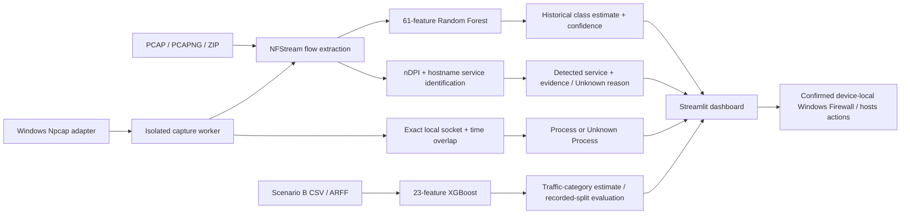

# AI-Powered Encrypted Network Traffic Classifier

Streamlit network intelligence dashboard for Windows. The three sections are **Monitor** (live evidence, traffic usage, and everyday blocking controls), **Analyze file** (one validated uploader), and **Settings** (adapter preference, model evaluation, and advanced blocking controls).

- PCAP, PCAPNG, or ZIP containing a capture: NFStream extraction, evidence-based service identification, and a separate Random Forest estimate (61 features).
- Scenario B CSV/ARFF: the trained XGBoost classifier (23 features, seven traffic classes).
- Live capture: a background NFStream capture with observed service evidence, conservative Windows process attribution, charts, searchable recent flows, CSV export, and separate Random Forest estimates.
- Scenario B evaluation: the original stratified 80/20 split with `random_state=42`, confusion matrix, precision, recall, and F1 scores.
- Blocking & Protection: device-local IP firewall rules, exact domain/observed website hosts entries, intended-versus-enabled status, confirmation, and rollback.

## Architecture and result meanings



Detected services use observed protocol or hostname evidence. A separate read-only Windows socket sampler can associate a flow with a process only when protocol, both endpoint addresses and ports, and capture time overlap exactly. A service name never proves the process or browser tab. Random Forest predicts five historical application classes; XGBoost predicts seven separate Scenario B traffic categories. Unknown and Ambiguous preserve uncertainty. The [final project report](reports/FINAL_PROJECT_REPORT.md) and [model audit](reports/model_evaluation/README.md) contain the demonstration method and per-class results.

## Windows 11 setup and launch

Use 64-bit Python 3.13. Install [Npcap from its official site](https://npcap.com/) before live capture; [NFStream's Windows notes](https://github.com/nfstream/nfstream) state that the capture driver is a separate installation. If Npcap was installed in restricted-admin mode, launch PowerShell as Administrator for capture. The application does not install or modify the driver.

From the project root in PowerShell, create a virtual environment only if one is not already available:

```powershell
py -3.13 -m venv .venv
.\.venv\Scripts\python.exe -m pip install -r requirements.txt
.\.venv\Scripts\python.exe -m pip check
```

The direct dependencies in `requirements.txt` are pinned to the Windows/Python 3.13 environment used for validation. Launch the dashboard:

```powershell
.\.venv\Scripts\python.exe -m streamlit run dashboard.py
```

The default address is http://localhost:8501. The validated environment used Windows 11 and Python 3.13.3. No dependency installation or upgrade was performed during release preparation.

NFStream capture requires Npcap and a working capture driver. The live-capture dropdown lists actual Npcap adapters with their descriptions. Select the adapter carrying your traffic; use Refresh interfaces after adapter changes. List the same sources without capturing:

```powershell
.\.venv\Scripts\python.exe -B tools\test_live_capture.py --list
```

Run PowerShell as Administrator when required for live capture, firewall changes, or hosts-file writes. **Monitor → Blocking & Protection** sits directly below Website & application usage. It offers observed-hostname and remote-IP Block actions, compact Website / Domain / IP previews, and the active-rule table. **Settings → Blocking & Protection** retains advanced choices, including inbound IP rules. Both views use the same backend and ignored runtime intent ledger at `data/blocklist.json`. Windows enforcement requires a preview and a dialog where the exact targets and coverage are confirmed. Removal also requires a dialog. Blocking affects this Windows device only.

### Blocking & Protection

**IP address:** Enter an exact IPv4 or IPv6 address. Outbound is the default; inbound is an explicit advanced choice. The preview warns that shared hosting and CDNs can make IP blocking affect unrelated sites. Loopback, link-local, multicast, unspecified, and broadcast destinations are refused. The app checks local interface addresses, default gateways, and active DNS resolvers read-only. A critical match requires an additional acknowledgement; if the inventory cannot be read, IP enforcement is disabled. A duplicate, disabled, or conflicting managed rule is not silently replaced. The status table verifies the rule's target, direction, action, enabled state, and unrestricted filters before treating it as enabled. Remove / Undo targets only the application's exact managed rule. See [Microsoft's Windows Firewall command guidance](https://learn.microsoft.com/en-us/windows/security/operating-system-security/network-security/windows-firewall/configure-with-command-line).

**Domain:** Enter one exact hostname. The app normalizes it and previews a managed Windows hosts entry before confirmation. Wildcards and subdomains are not included, and the app leaves unrelated hosts entries untouched. The table checks whether the managed entry exists; Undo removes only that exact managed entry. Hosts-file changes may require elevation and do not guarantee every browser or DNS path uses the entry.

**Website / service:** In Monitor, a Block action beside a directly observed hostname fills the exact target in the compact form. An IP action appears only when one flow endpoint matches this device's interface addresses; it still requires an exact preview and confirmation. Use **Refresh observed targets** to read newly completed flows without clearing a pending preview. Settings lets you choose a service and specific hostnames from recent activity. Only rechecked direct hostname evidence can produce website rules; DNS-only observations, generic CDNs, ambiguous results, and RF predictions cannot. The preview lists each exact hostname and evidence source. Enforcement uses those hosts entries, never a service-wide IP range. If no suitable hostname was observed, use Domain for a hostname you verified independently. A website may use other domains, subdomains, encrypted DNS, direct IP access, or cached connections, so these rules do not promise complete blocking.

The table shows target, type, enforcement method, **This Windows device only** scope, status, created date, and an Undo / Remove route. “Intent only” means no managed rule is currently verified. “Enabled rule present” means its local configuration exists; it is not a packet-level guarantee. The app never changes the firewall or hosts file merely by monitoring, identifying a service, or saving an intent.

For an authorized manual enforcement check on a disposable Windows demonstration machine, launch the app from an **Administrator PowerShell** after the setup above:

```powershell
.\.venv\Scripts\python.exe -m streamlit run dashboard.py
```

In Monitor, preview `192.0.2.10` as an outbound IP and `example.invalid` as an exact domain. Review each proposed rule, type `BLOCK` in the confirmation dialog, verify the table changes from intent to an enabled rule or managed hosts entry, then select the target, click **Remove / Undo selected**, and type `REMOVE`. These reserved example targets avoid intentionally disrupting a real service, but the actions still modify this device and require authorization. Check a detected website proposal without applying it to see the exact observed hostnames and evidence. Do not use a default gateway, DNS resolver, shared CDN IP, or a service you depend on as a demonstration target.

Live capture uses one isolated Python worker and one NFStream meter. Windows multiprocessing imports the worker module rather than executing the Streamlit dashboard in child processes. Each browser session keeps one controller across reruns. Start rejects duplicate workers. Stop requests cooperative cleanup, then terminates and joins the owned process tree if needed, including on idle adapters. A session-specific temporary stop file avoids sharing stdin with Windows multiprocessing. Switching away from Monitor stops the session; a disconnected or nonrefreshing browser loses its capture lease after 30 seconds. Normal interpreter shutdown also cleans up sessions. Cleanup errors block restarting that controller and remain visible.

Monitor refreshes capture status, cumulative flow and byte counters, service charts, and a recent-flow trend every two seconds. Search and status filters apply to the retained recent connections. Technical endpoints, TCP/UDP totals, nDPI fields, Unknown reasons, and historical RF estimates are in an expander. Packet/byte totals refer to completed flows, not every packet currently on the wire. At most 500 recent rows and ten diagnostics are retained; lifetime counters continue increasing. Idle/active flow timeouts are five/ten seconds, so ongoing traffic is split into bounded flow windows.

The Monitor blocking section sits outside the automatic two-second capture and recent-connection refresh fragments. A chart refresh does not submit a rule, clear a preview, or stop capture. Click **Refresh observed targets** when newly captured hostnames or remote IPs should appear in the Block action list; this preserves the current preview.

Live capture explicitly enables 32 nDPI dissections per flow. The worker preserves nDPI application name, category, guessed flag, confidence, and requested server name. Service identification uses direct hostnames from TLS/HTTP/QUIC metadata and strong nDPI application evidence; it does not use Random Forest classes. The editable `data/service_domains.json` holds direct domains, resource domains, and shared infrastructure domains. Domain matching requires an exact hostname or a real subdomain boundary. Direct hostname and strong nDPI results are labeled as hostname or protocol evidence. Resource domains and weaker/guessed nDPI results are heuristic. Conflicting evidence and shared infrastructure are ambiguous. Missing evidence is unknown. nDPI port-only confidence never identifies a service.

The map also includes verified provider domains for 360 Total Security and Tradedoubler and the specific `chat.openai.com` hostname for ChatGPT. Specific hostnames take precedence over broader parent domains; `api.openai.com` remains OpenAI, while `chat.openai.com` maps to ChatGPT. OpenAI asset domains are heuristic OpenAI contacts, not proof of a ChatGPT visit. Generic CDN domains, shared IP addresses, and ports never establish a website. The worker now also preserves NFStream's client/server fingerprints, HTTP user agent, and content type in the recent-flow CSV when available. Fingerprints and user agents are diagnostic metadata, not proof of a process or executable.

Mapping references: [360 Total Security](https://www.360totalsecurity.com/en/), [Tradedoubler](https://www.tradedoubler.com/), and [OpenAI's ChatGPT network domains](https://help.openai.com/en/articles/9247338-network-recommendations-for-chatgpt-errors-on-web-and-apps). Add only domains with clear service ownership; keep shared hosting domains in `shared`.

The live dashboard groups Unknown flows by cumulative reason: DNS-only observation, visible hostname outside the map, missing or invalid hostname, absent/unsupported nDPI application, port-only nDPI result, or a protocol with no service identity. "Encrypted flow without hostname" means the TLS/QUIC flow has no reported server name; it does **not** prove ECH was used. These reasons describe evidence availability, not ground-truth causes. The live table and CSV retain the per-flow reason. A service hostname identifies a contacted domain, not which Windows executable opened the connection.

NFStream may report a DNS query in `requested_server_name`. The live table shows a mapped DNS query service, if any, with `Lookup only`; the detected service stays Unknown because a lookup alone does not establish a connection. No DNS lookup is attached to a later flow without a reliable association. TLS ECH, encrypted DNS, HTTP/3 and QUIC metadata limits, shared CDNs, and unresolved connections can obscure websites. A detected hostname or protocol is evidence about a flow, not a guarantee of the website a person viewed. No payload decryption is attempted.

On Windows live capture, a bounded read-only socket sampler uses `psutil.net_connections(kind="inet")`. It records only connected TCP sockets or UDP sockets with a remote endpoint, then requires an exact protocol and bidirectional address/port tuple plus overlap with NFStream's first/last-seen timestamps. Multiple owners, absent timestamps, a closed short-lived socket, access denial, or unavailable endpoint information yield **Unknown Process**. The process name/PID/executable are local OS observations, not a website or browser-tab identity. Offline files cannot be reliably attributed to the current machine's processes. Process paths and network metadata are sensitive; the CSV download requires acknowledgement and is not written into the repository.

The service charts use cumulative completed-flow totals. The recent-flow CSV export includes endpoints, packet/byte counts, nDPI fields, process evidence when available, service reliability, and separate Random Forest output. The export includes only the retained recent rows, not all historical flows.

Live RF predictions use the same saved 61 feature names, ordering, numeric validation, and undefined-statistic handling as PCAP prediction. Missing or unavailable features skip classification and show the reason, rather than fabricating a feature vector. Model errors retain observed traffic with a warning. Outputs and confidence scores are explicitly marked as model estimates; these training classes and confidence scores do not establish the identity of arbitrary modern applications. Short live flow windows can differ from the original training capture distribution.

For a bounded physical capture check, copy an exact adapter name from `--list`:

```powershell
$device = '<adapter name copied from --list>'
.\.venv\Scripts\python.exe -B -u tools\test_live_capture.py --interface $device --duration 20 --require-flows
```

Generate traffic on that adapter while the check runs (browse a website or play a video). The command prints observed flow totals and RF estimate counts, returns a nonzero exit code on errors/no flows, and always stops its worker. It does not change firewall rules or the hosts file. Check the worker on an existing capture without opening an adapter:

```powershell
.\.venv\Scripts\python.exe -B -u tools\test_live_capture.py --pcap 'C:\path\to\your\sanitized-sample.pcapng' --duration 20 --require-flows
```

To check service identification on Windows, start the dashboard, choose **Monitor** and the active Npcap adapter, then click **Start monitoring**. Open `https://www.youtube.com`, `https://www.instagram.com`, or `https://chatgpt.com` in a browser on that adapter. Wait for completed flows, then inspect hostname, service, process, evidence, and status. A direct hostname should show the corresponding service with hostname evidence when nDPI exposes it. If ECH, encrypted DNS, a shared CDN, or capture timing hides the hostname, Unknown or Ambiguous is expected. A process may stay Unknown if its socket closed before a sample or no exact tuple/time match exists. Inspect RF output only in technical details, download the acknowledged recent-flow CSV, click **Stop monitoring**, and restart to verify counters reset. The command-line check can show the same observed service totals without Streamlit:

```powershell
.\.venv\Scripts\python.exe -B tools\test_live_capture.py --list
$device = '<copy an exact adapter name from the list>'
.\.venv\Scripts\python.exe -B -u tools\test_live_capture.py --interface $device --duration 30 --require-flows
```

Model artifacts are loaded from the repository's `models` directory regardless of the launch working directory. Random Forest uses `rf_model.pkl` and `feature_names.pkl`; current RF models already return application names, so the retained legacy `label_encoder.pkl` is not used for them. XGBoost uses the three `scenario_b_xgb_*.pkl` files. Missing, unreadable, or mismatched files produce actionable errors. Existing experiment models are preserved and are not selected automatically.

**Analyze file** accepts PCAP, PCAPNG, ZIP, CSV, and ARFF through one uploader. It verifies capture magic bytes and archive members; CSV/ARFF must be UTF-8 text. Tabular columns must match exactly one saved feature schema: 61 RF features or all 23 Scenario B features from `src/scenario_b.py`. A `label` column is optional. Ambiguous, unrelated, empty, and nonnumeric inputs are rejected with a reason. Undefined numeric statistics (`NaN` or infinity) are replaced with zero by the existing model preprocessing. The upload limit is 200 MB, matching Streamlit's default. Capture analysis presents observed services and Unknown reasons above the historical RF estimates. Settings keeps both recorded model reports and a button to recalculate Scenario B's split.

Evaluation expects `Scenario B-ARFF.zip` in your Windows user's Downloads folder, containing `Scenario B-ARFF/TimeBasedFeatures-Dataset-15s-AllinOne.arff`. Override its location before launching if necessary:

```powershell
$env:SCENARIO_B_DATASET = 'D:\Datasets\Scenario B-ARFF.zip'
.\.venv\Scripts\python.exe -m streamlit run dashboard.py
```

An unavailable evaluation dataset displays a warning while the other app features remain available. Evaluation uses the same split settings as the training script; its score alone does not establish accuracy on new live traffic.

Run the regression suite without installing a test framework:

The complete 150-test run uses locally generated `data/test_flows.csv` and `data/training_flows.csv` from the cited dataset. Those CSVs are intentionally ignored and are not in a fresh GitHub clone. The Scenario B metric test also needs the external archive; two optional capture integrations need `TRAFFIC_TEST_PCAP`. A fresh clone cannot reproduce the full count until the public dataset-derived fixtures are generated locally. Never substitute private runtime captures for test fixtures.

After obtaining the public archive from UNB, generate the local RF tables from the project root without retraining the saved model:

```powershell
$env:NONVPN_DATASET = 'C:\path\to\NonVPN-PCAPs-01.zip'
.\.venv\Scripts\python.exe -B tools\build_training_dataset.py
.\.venv\Scripts\python.exe -B tools\split_dataset.py
```

```powershell
.\.venv\Scripts\python.exe -B -m unittest discover -s tests -v
```

The tests use real trained models, temporary blocklist/hosts files, mocked firewall commands, and hardware-free subprocess fixtures for lifecycle failures. By default two optional real NFStream integration tests are skipped; enable both using a capture you already have:

```powershell
$env:TRAFFIC_TEST_PCAP = (Resolve-Path 'temp_upload\AIMchat2.pcapng').Path
.\.venv\Scripts\python.exe -B -m unittest discover -s tests -v
Remove-Item Env:TRAFFIC_TEST_PCAP
```

Before the service-identification changes, physical verification used a local Wi-Fi adapter: a 20-second session collected 53 real flows (35 TCP, 17 UDP, one other), and all 53 received RF estimates. The same adapter was exercised through the dashboard's Start/Stop buttons using headless AppTest: four flows were classified, the prior live charts rendered, and Stop left the worker and observed descendants exited. These checks verified the earlier capture lifecycle, not the new service labels.

Prior service-identification validation: 61 regression tests passed with both real PCAPNG integration tests enabled; all 37 Python files passed syntax parsing, seven core source modules imported, `git diff --check` passed, and headless Streamlit health/root requests returned HTTP 200. The existing PCAPNG produced 91 completed flows through the isolated worker and 91 RF estimates; its observed metadata identified no mapped contacted services, so all 91 correctly remained Unknown. A bounded physical capture on a local Wi-Fi adapter collected 270 real flows and 270 RF estimates. Observed TLS hostnames identified YouTube and ChatGPT; nDPI also identified Google and Microsoft flows. A separate headless dashboard run captured 12 real flows, displayed ChatGPT in the recent-flow table, rendered all four live charts, and stopped cleanly. An Instagram request timed out, so Instagram identification remains unverified on this adapter. These checks demonstrate observed service evidence in this environment, not universal detection accuracy.

Unknown-reason development used a separate 25-flow physical Wi-Fi capture. Reapplying the old and new service rules to the **same captured metadata** changed 1 identified / 24 Unknown to 13 identified / 12 Unknown. All 12 new identifications had an observed provider hostname. The remaining 12 had no server hostname: six were generic TLS and six had nDPI `Unknown`. These figures describe that one short sample, not the user's earlier 468-flow dashboard session or a general identification rate.

After this change, another bounded physical Npcap check collected eight flows and identified two flows using provider-hostname evidence. The remaining six were three DNS-only, one TLS without a hostname, and two without a usable nDPI application or hostname. The worker stopped cleanly and carried the documented nDPI metadata fields. No dependencies were installed or upgraded, and no models were retrained.

Final checks for the Unknown-reason update: 63 regression tests passed with both optional real PCAPNG integrations enabled, 37 Python files passed syntax parsing, eight core modules imported, `git diff --check` passed, and headless Streamlit health and root requests returned HTTP 200.

The original Scenario B evaluation processed 3,752 test flows and reported 91.20% accuracy on a random-flow split. Firewall/hosts enforcement writes remain untested here. For manual browser verification, select **Monitor** and your active adapter, click **Start monitoring**, generate traffic, confirm counters/table/charts update, search and filter recent connections, expand technical details, click **Stop monitoring**, and start again. Also check browser disconnect cleanup after 30 seconds, idle-adapter Stop, adapter unplug/reconnect errors, and extended monitoring on your hardware. Windows Firewall and hosts-file changes remain explicit separate actions.

Latest controlled validation on Windows: a loopback HTTP request produced one captured flow, matched `python.exe` by exact socket/time evidence, and correctly stayed Unknown service. A source-bound Google HTTPS request on Wi-Fi produced two captured flows, both matched `python.exe`, but nDPI exposed generic TLS without a server name; both correctly stayed Unknown rather than being labelled Google from the destination IP or port. The new validation therefore verifies process attribution and conservative Unknown handling, not a new website-detection rate. Previously observed hostname and nDPI service detections are recorded above. No firewall or hosts setting was changed.

## Throughput history and local activity alerts

Monitor shows download/upload **Mbps from OS byte counters for the selected device adapter**, separately from completed NFStream flow bytes. An exact Npcap GUID-to-Windows adapter match is required. Samples are normally taken every two seconds and use actual monotonic elapsed time. The first sample after Start, a counter reset, a missing adapter, stale data, or an unsupported mapping has no rate; stopped cards show no current measurement. A valid zero-traffic interval shows zero. These are interval averages, not instantaneous bandwidth, link capacity, or router-wide totals.

Use Last 15 minutes, Last hour, Today (local day), Last 7 days, or Custom to inspect usage. Persisted bandwidth uses minute buckets averaged over measured intervals only; partial minutes and missing capture periods are not filled with zeros. Select one stored adapter history at a time. Adapter counters can include traffic the flow stream misses and may differ due to VPNs, offload or capture boundaries. Never add OS-counter bytes to completed-flow bytes or sum overlapping adapters as unique network usage.

Flow direction uses the selected adapter's verified local addresses, or exact connected-socket evidence when available. IPv4, IPv6 and mapped addresses are normalized. Both-local endpoints, loopback, missing endpoints or inconsistent byte counters remain unassigned. Service/process summaries include observed bytes, flow counts, and last connection time; direction totals cover only reliably directed flows. Remote destinations are shown only from recent in-memory capture rows and are never stored in SQLite.

Settings contains local persistence, optional service/process names, retention (default seven days; configurable 1?30), alert thresholds, and a confirmed Clear all local history action. The default store is ignored `data/local_history/activity.sqlite3`; `NTC_HISTORY_DIR` can select a private directory. SQLite WAL, parameterized statements, secure deletion/compaction and row caps bound storage. Limits are 45,000 adapter-minute rows, 50,000 aggregate flow rows, 50,000 deduplication IDs, 10,000 state fingerprints and 1,000 alerts; a busy store can retain less than the selected period. Pruning runs on startup, visible history refresh and during monitoring. History is unavailable while the app is off. Names are off by default; enabling them stores only service labels and process basenames. No raw packets, endpoints, hostnames or executable paths are persisted. Disabling storage stops new usage writes; clear existing records separately. Settings and an opaque capture-coordination lease remain after history deletion. The local SQLite file is not encrypted; protect the Windows account and private backups.

A bounded background queue records each capture event once; UI reruns only read snapshots. A shared capture lease prevents simultaneous app sessions using the same database from recording overlapping captures. Interrupted processes can leave a lease for up to 60 seconds. Separate history directories cannot coordinate their captures, so their totals may overlap. Queue overflow, database locks, corruption or write failures produce visible gaps/warnings and do not stop packet capture. Retry after fixing access/locks or restoring a private database backup; a corrupt database is never silently deleted.

All five alert types can be disabled individually: new identified service, new reliably attributed Windows process, high OS-counter Mbps/completed-flow data, repeated connections to an explicitly selected destination, and managed blocking status changes. The connection/flow-usage window and thresholds are configurable. Flow-usage bytes are accumulated in bounded one-second buckets; the threshold window can include up to one extra boundary second and already reflects flow-completion delays. Busy seconds retain all recorded bytes rather than dropping older event values. Destination comparison stores only a fingerprint, which is not an anonymization guarantee. DNS-only lookups do not count as destination connections. Rule checks are read-only and approximately every 30 seconds while capture or the visible alerts panel is active. An inspection failure reports unverified status, not a removed rule. A configured rule is not proof that every traffic path is blocked.

Alerts use first-seen deduplication and per-type/target cooldowns (default 60 seconds), a bounded local list, at most three new toasts per refresh, and persisted read/dismiss state. The panel shows up to 100 recent undismissed records and offers Mark read, Dismiss and Clear. Alert messages are generic by default; opting into names permits service/process labels. Unknown traffic is never labelled malicious. Notifications stay local and never enforce firewall rules.

Current validation uses synthetic fixtures, including a generated PCAPNG for the two real NFStream worker/upload integrations. The physical Windows results and remaining measurement limits are recorded in the [final project report](reports/FINAL_PROJECT_REPORT.md).

## Privacy and troubleshooting

Live flows and recent-flow CSV exports may include personal IP addresses, contacted hostnames, timing, user-agent strings, and device fingerprints. Export only when necessary, keep the CSV in a private location, and redact actual network metadata from screenshots. `data/blocklist.json`, `temp_upload/`, `*.pcap`, `*.pcapng`, generated `data/*.csv`, logs, `.env` files, and `models/experiments/` are ignored by Git. An earlier commit already contained runtime blocklist and capture data; current index removal does not erase Git history, so review that history before public publication.

If no adapters appear, check that Npcap is installed, restart PowerShell after installation, and try an elevated shell if the driver was installed with restricted access. If flows stay at zero, confirm the chosen adapter carries traffic, generate a fresh connection, and wait for a completed flow window. If the model or Scenario B evaluation is unavailable, check the `models/` artifacts or the `SCENARIO_B_DATASET` path; the rest of the dashboard should remain available. A hosts file that is not valid UTF-8 is rejected for writing to avoid corrupting its contents; inspect and back it up before editing manually. Firewall and hosts tests use mocks and temporary files, so exercise real enforcement and Unblock only on an authorized demonstration machine.

## Reproducible model audit

Dataset attribution: University of New Brunswick, Canadian Institute for Cybersecurity, [ISCXVPN2016 VPN-nonVPN dataset](https://www.unb.ca/cic/datasets/vpn.html). Cite Gerard Drapper Gil, Arash Habibi Lashkari, Mohammad Mamun, and Ali A. Ghorbani, “Characterization of Encrypted and VPN Traffic Using Time-Related Features,” ICISSP 2016, pp. 407–414. UNB's [dataset redistribution guidance](https://www.unb.ca/cic/datasets/) requires citing both the dataset and its research paper.

Run `.\.venv\Scripts\python.exe -B tools\evaluate_models.py` from the project root. The generated [model evaluation report](reports/model_evaluation/README.md), [machine-readable results](reports/model_evaluation/results.json), class metrics, and confusion-matrix CSVs document both saved models separately. The saved Random Forest exactly reproduced its local PCAP-derived training run and scored 56.72% on its existing test PCAPs; related a/b recording segments overlap that split, so this is not a five-class independent session score. A new session-held-out comparison scored 36.34% for a freshly retrained RF baseline and 34.18% for a deduplicated, source-capped candidate. The candidate remains under `models/experiments/rf_session_candidate/`; the dashboard still loads `models/rf_model.pkl`. The XGBoost 91.20% result reproduces on the original stratified random-flow split, which lacks session IDs. XGBoost was not retrained. See the report for per-class support, precision, recall, F1, confusion matrices, duplicate-vector counts, and academic limitations.
